<p align="center">
  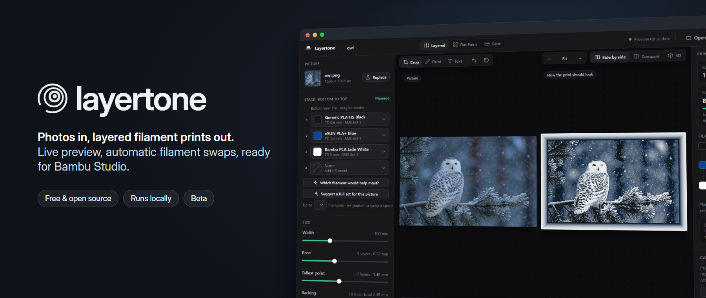
</p>

<p align="center">
  <a href="https://github.com/Akoozie/layertone/releases"></a>
  
  
  <a href="LICENSE"></a>
</p>

## From photo to print

<p align="center">
  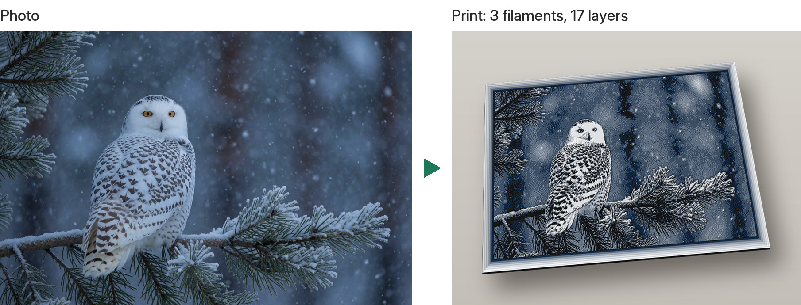
  <br><br>
  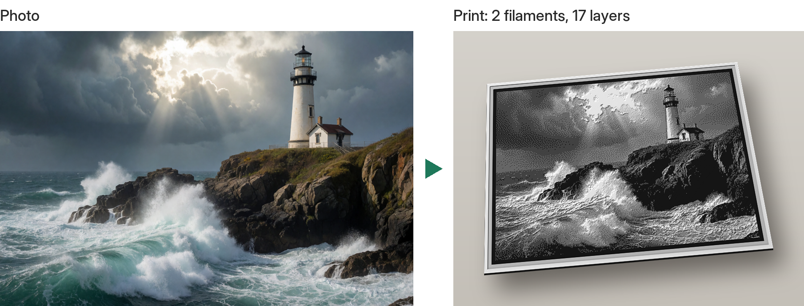
</p>

Left: the photo you start from. Right: a render of the print layertone makes from it, with only
**black, blue and white** filament (owl) or just **black and white** (lighthouse). The tones come from how
thick each filament is stacked, not from more colours.

---

## What it does

layertone takes a picture and a short list of filaments (your **Stack**) and works out how tall every
point of a thin panel should be, and at which layers the printer should switch filament (the **Swaps**).
Light filament over dark gets lighter the thicker it is, so a few colours print as a full range of tones.

You get a Bambu Studio project (`.3mf`) with the filament changes already placed: open it, slice, print.

- **Live preview** of how the print will look, with a layer slider that shows the print stopping at any layer
- **Automatic swap planning**: the app picks the swap layers that bring the preview closest to the picture
- **Up to 8 filaments**: past the 4 AMS slots, the print pauses for a spool change at the right height
- **Filament advice**: "Which filament would help most?" and "Suggest a full set for this picture"
- **Picture tools**: crop, paint, text, grain smoothing, colour reduction, detail boost and dithering
- **Frames** in ten styles, **stands**, **business cards** and **walls** made of tiles (see below)
- **3D view** of the finished relief, light and dark theme, works on a phone too
- **No cloud, no account**: everything runs on your own computer

## The app

<p align="center">
  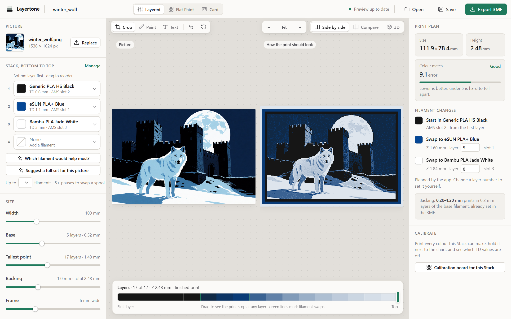
</p>

Pick your filaments bottom to top, move the sliders, and the preview updates in well under a second.
The right panel shows the size, how close the colours get, and every filament change with its height.

<table>
  <tr>
    <td width="50%">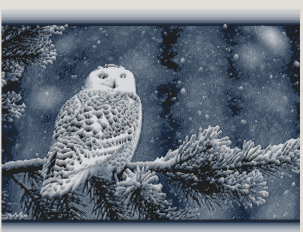</td>
    <td width="50%">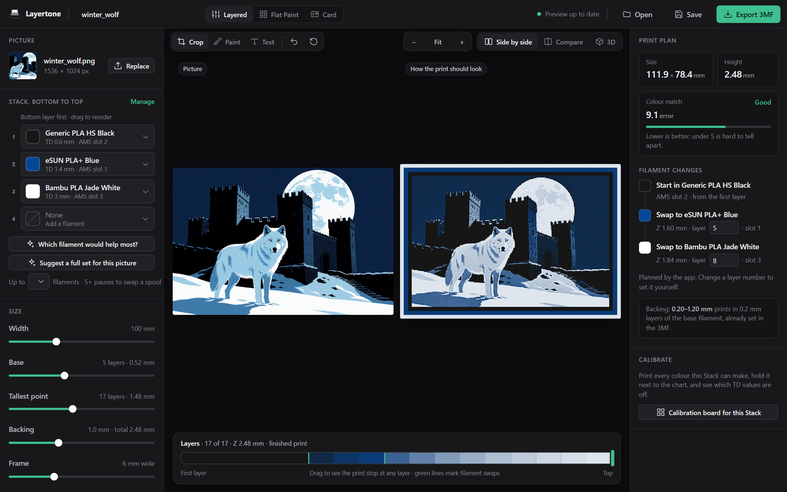</td>
  </tr>
  <tr>
    <td align="center">3D view: turn and zoom the relief before printing</td>
    <td align="center">Dark mode follows your system setting</td>
  </tr>
</table>

## Frames

Add a border round the picture and pick its shape. Frames use only the filaments already in your
Stack, so they never add a filament change. Light parts stand tall, dark parts sit low.

<p align="center">
  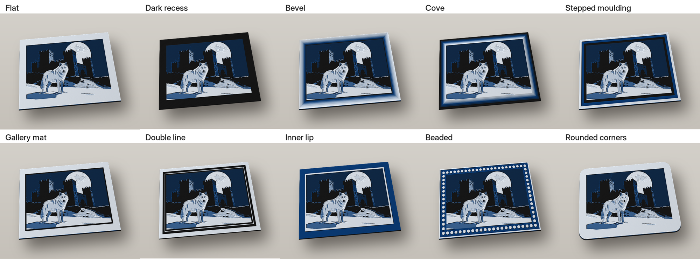
</p>

## Business cards

Card mode makes 85 x 55 mm cards with crisp text, an optional QR code and an optional picture,
up to 8 cards on one plate. Bring your own layout as an SVG if you prefer (Inkscape, Figma).

<table>
  <tr>
    <td width="50%">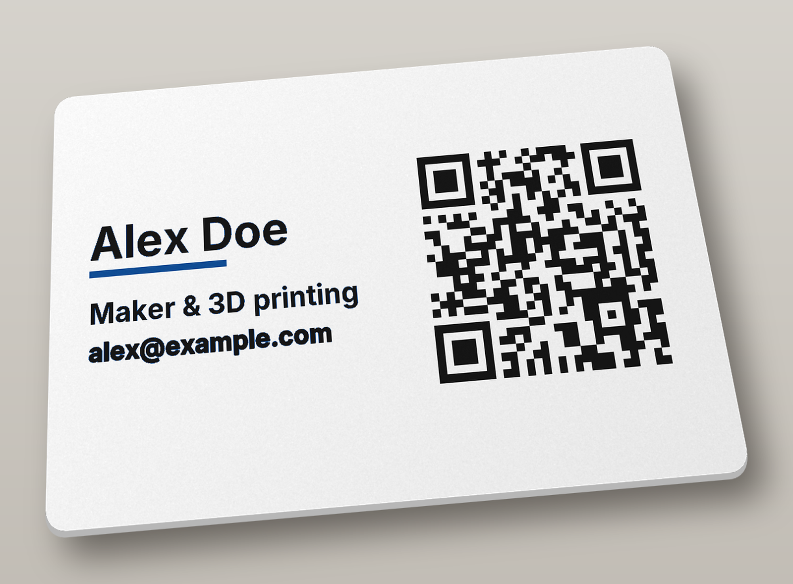</td>
    <td width="50%">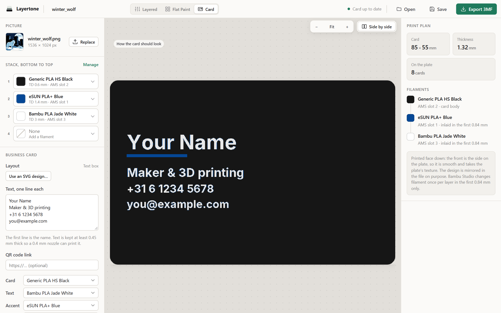</td>
  </tr>
</table>

## Walls

A picture bigger than the print bed prints as a grid of tiles. Every tile shares one swap plan, so the
colours match across the seams. Magnets, butterfly keys or peg plates are cut into the back, and each
tile is labelled so you know where it goes.

<table>
  <tr>
    <td width="60%">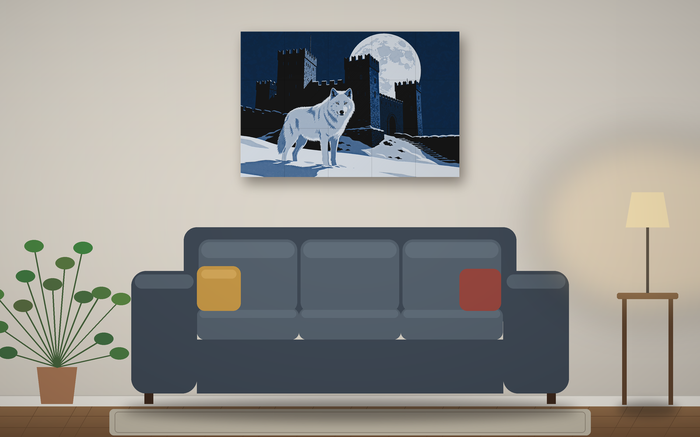</td>
    <td width="40%">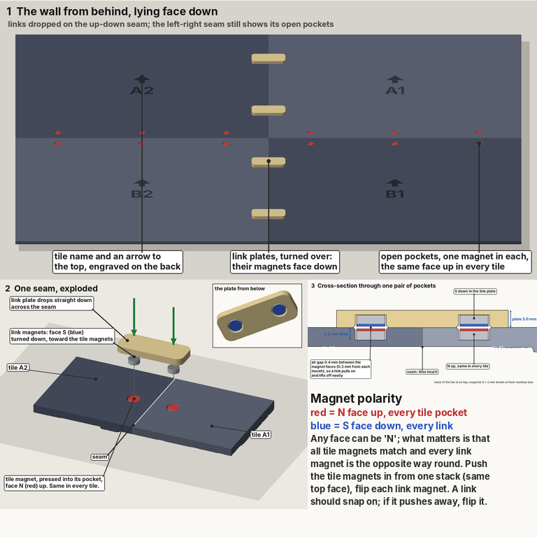</td>
  </tr>
</table>

## Install

layertone is a Python package. You need Python 3.10 or newer.

```bash
pip install "layertone @ https://github.com/Akoozie/layertone/releases/download/v0.1.0-beta.2/layertone-0.1.0b2-py3-none-any.whl"
```

Or from source:

```bash
git clone https://github.com/Akoozie/layertone
cd layertone
pip install -e .
```

## Quick start

**The app:**

```bash
layertone-ui
```

Your browser opens http://127.0.0.1:8765. Drop a picture on the page, choose filaments, then **Export 3MF**.

To use it from a phone or tablet on the same network, run `layertone-ui --host 0.0.0.0` and open the
address it prints. The page has no password, so only do this on a network you trust.

**The command line:**

```bash
# black and white, 100 mm wide
layertone photo.jpg --stack black,jade_white --width 100

# three colours with a stepped frame
layertone photo.jpg --stack black,blue,jade_white --frame 6 --frame-style steps

# a 2 x 2 wall held together with magnets
layertone poster.png --width 450 --wall 2x2 --join magnets

# a business card with a QR code
layertone-card "Alex Doe" "Maker" "alex@example.com" --qr https://example.com --stack jade_white,blue,black
```

Each run writes `<name>.3mf` (Bambu Studio project), `<name>.stl` and `<name>.png` (preview), and prints
the swap heights. Try it with the demo pictures in [`examples/pictures`](examples/pictures) (`owl.png`, `lighthouse.png` and two illustrations).

## Commands

| Command | What it makes |
|---|---|
| `layertone` | A layered print from a picture (plus frames, stands and walls) |
| `layertone-ui` | The app in your browser |
| `layertone-card` | Business cards |
| `layertone-stand` | A stand sized to a print |
| `layertone-board` | A calibration board: one tile per colour your Stack can make |
| `layertone-swatch` | A swatch for measuring one filament's TD |

Run any of them with `--help` for every option.

## Get the colours right

The preview depends on each filament's **TD** (transmission distance: how thick a layer has to be
before it hides what is under it). The values in `src/layertone/filaments.json` come from maker tables
or are estimates. To measure your own:

1. `layertone-swatch --stack black,jade_white` and print it.
2. Find the first bar you can't tell apart from the reference rail.
3. `layertone-swatch --matched N --filament jade_white` saves the measured TD.

`layertone-board` prints every colour a Stack can make next to what the app expects, so you can see at
a glance which filaments are off.

## Printer support

layertone is built and tested on a **Bambu Lab A1 with AMS lite** and **Bambu Studio**. The 3MF is
filled from an A1 project template (0.08 mm layers), so the print settings carry over. Other Bambu
printers should work after changing the printer in Bambu Studio; other slicers can use the STL plus the
printed swap heights.

## Status: beta

layertone is in beta. It works end to end, but expect rough edges:

- TD values are estimates until you calibrate your own filaments.
- Wall joins (magnet fit, seam alignment) are tested on short runs, not yet on a full wall.
- Thin frame bands (the inner line of "Double line" under 6 mm) may be too thin for a 0.4 mm nozzle.

Bug reports and print photos are welcome in [Issues](https://github.com/Akoozie/layertone/issues).

## How it works

- **Colour model:** each filament hides what is under it a little more with every layer, set by its
  TD. layertone predicts the colour of every possible stack height from that.
- **Swap planning:** it tries the possible swap layers, scores each plan by how close the predicted
  colours get to the picture (CIE colour difference), and keeps the best one.
- **Heights:** every pixel gets the stack height whose predicted colour is nearest, then specks too
  small to print are cleaned up and the surface is turned into a light mesh.
- **Export:** the mesh goes into a Bambu Studio project template with the filament changes placed at
  the swap heights.

The engine is plain Python (numpy, Pillow); the page is a single HTML file served by Python's own
HTTP server, with no build step.

Run the tests with `python -m pytest -q`.

## Credits

- Inspired by layered "filament painting" prints popularised by HueForge. layertone is an independent
  project, not affiliated with HueForge, Bambu Lab or Kromacut, and uses none of their code.
- [Inter](https://rsms.me/inter/) font (SIL Open Font License) and [three.js](https://threejs.org) (MIT) are bundled.
- Demo pictures are AI-generated (Krea 2, run locally).

## License

[MIT](LICENSE)
